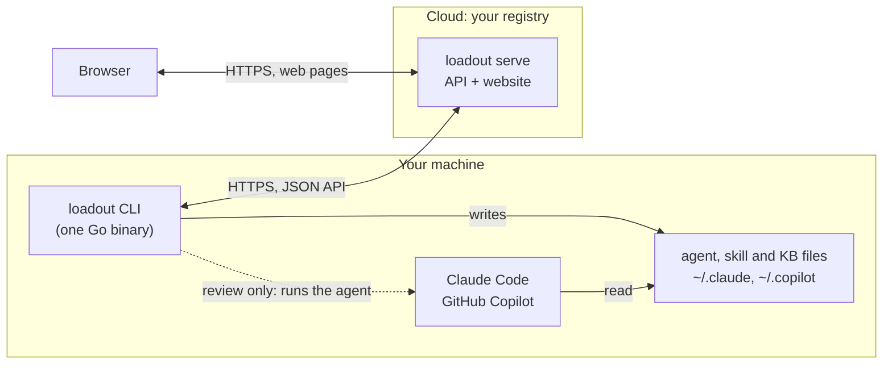
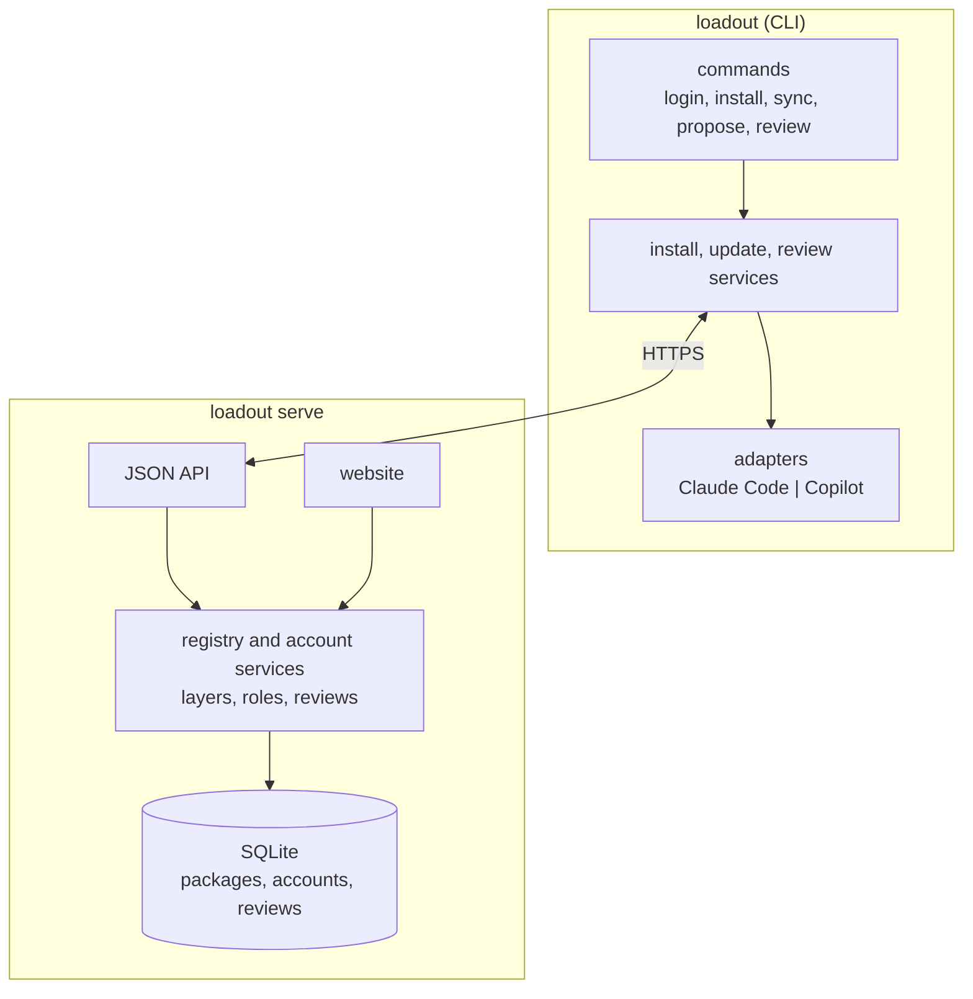
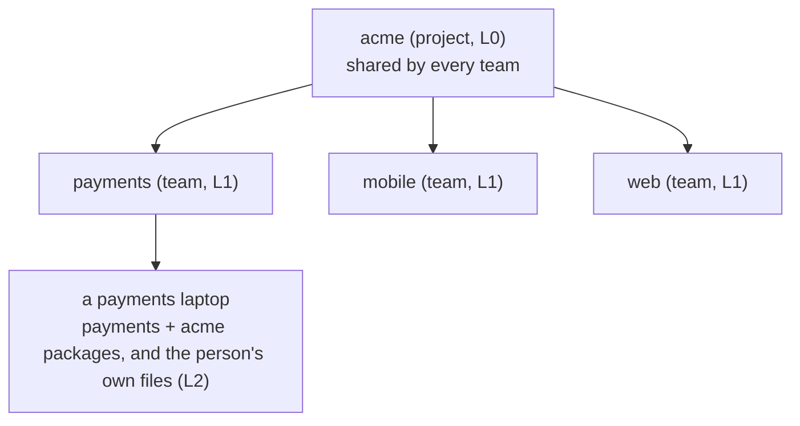
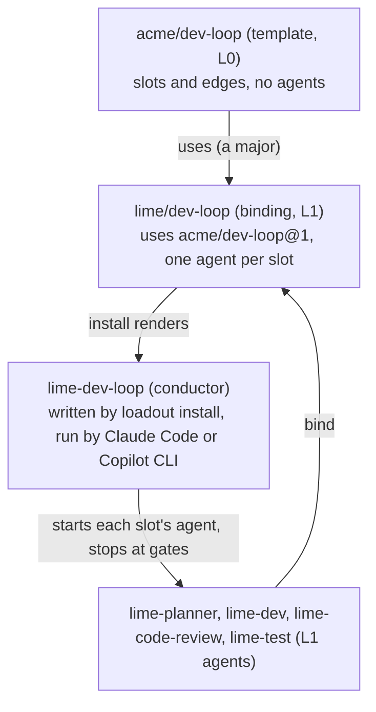
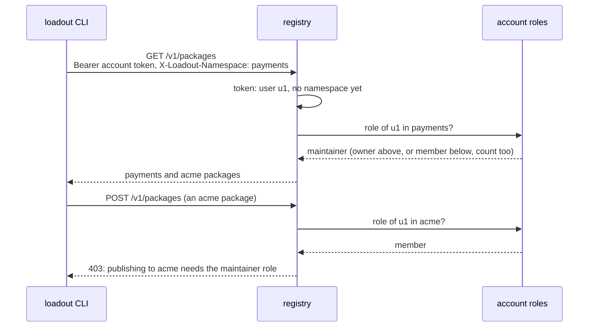
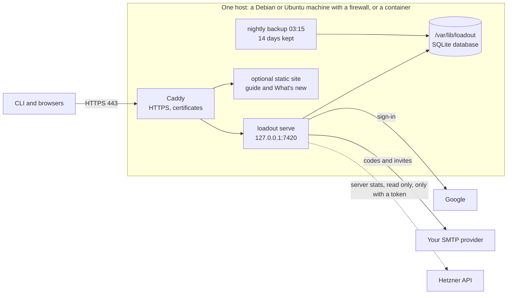

# Architecture

The diagrams of loadout, and where the technical docs are. Everything AI
stays on the user's machine; the registry only stores and serves files,
accounts and reviews.

## Technical docs

| Doc | What it covers |
|---|---|
| [DESIGN.md](DESIGN.md) | Packages and kinds, registry, layers, roles, login, review, web pages, the rules that protect users. The source of truth. |
| [STANDARDS.md](STANDARDS.md) | The Go rules this codebase follows. |
| [UI.md](UI.md) | Web UI rules and the Apple HIG review record. |
| [GUIDE.md](GUIDE.md) | The user guide, published at https://loadout.lat/docs/. |
| [CHANGES.md](CHANGES.md) | What each deploy added and fixed, published at https://loadout.lat/docs/whats-new/. |
| [plans/](plans/) | One plan per larger feature, such as [one-login](plans/one-login.md) and [skills-and-kb](plans/skills-and-kb.md). |
| [deploy/](../deploy/README.md) | Running your own registry: the deploy script, Caddy, services, backups. |
| [CONTRIBUTING.md](../CONTRIBUTING.md), [SECURITY.md](../SECURITY.md) | How to change loadout, and how to report a vulnerability. |

## The big picture



## Inside the binary

The same binary is the CLI and the server; each side is thin on top of
shared services.



## Layers

A project (L0) sits above its teams (L1). A team reads its own packages and
the project's; when both ship the same name, the team's wins. Files a person
made themselves (L2) are never touched.



A pipeline package depends on other packages across layers. The project
writes a template (its slots and the edges between them). A team writes a
binding that names the template and one of its own agents for each slot.
On a laptop, loadout renders the binding into a conductor agent, which the
person's own tool runs and which starts the team's agents in turn.



## One login, many teams

`loadout login` gives one account token per registry. Each request names the
team it is about, and the registry checks the user's role there at that
moment. See [plans/one-login.md](plans/one-login.md).



## Install and update

```mermaid
sequenceDiagram
  participant Dev as teammate
  participant CLI as loadout CLI
  participant Reg as registry
  participant Tools as Claude Code / Copilot
  Dev->>CLI: loadout install --all
  CLI->>Reg: list and fetch packages (digest checked)
  CLI->>Tools: write agents, skills, KBs where each tool looks
  Note over Dev,Tools: later, from cron or by hand
  Dev->>CLI: loadout sync
  CLI->>Reg: newer versions?
  CLI->>Tools: auto: install them; notify: say so; pin: stay
  Note over CLI,Tools: a file the person edited is never overwritten
```

## What is in the cloud


