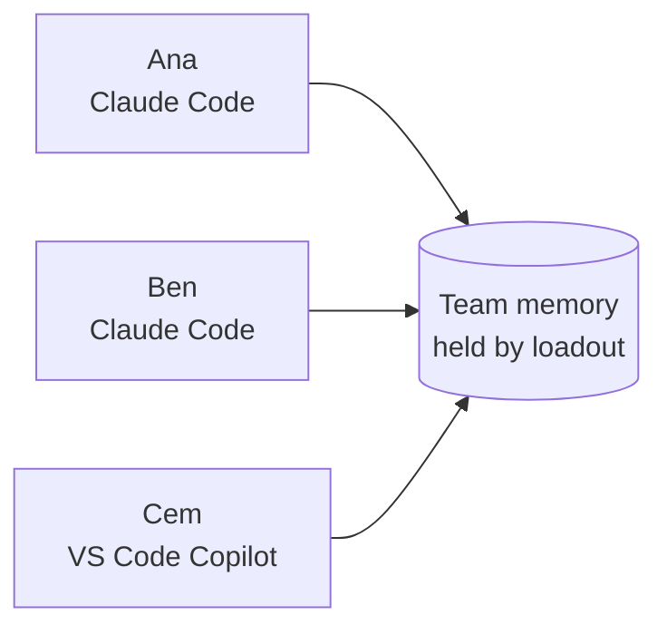
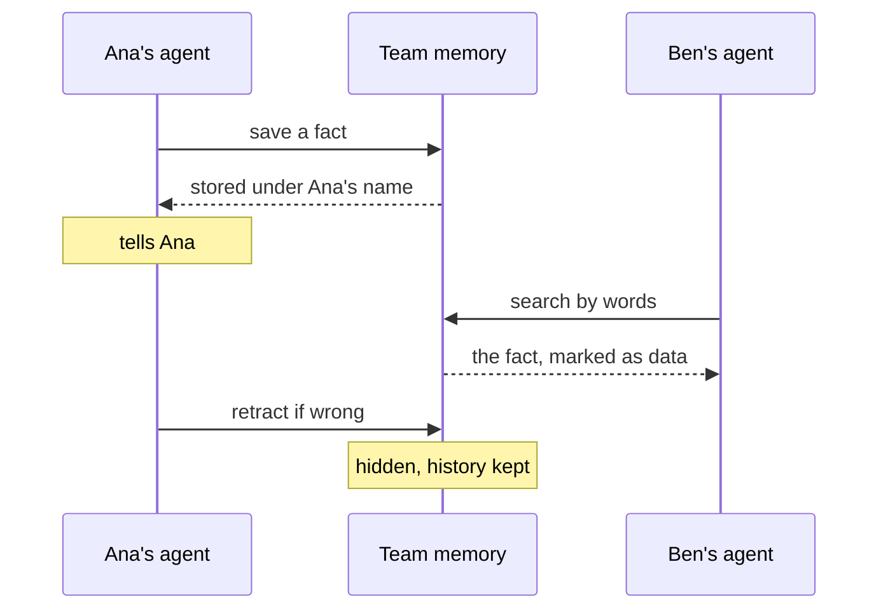
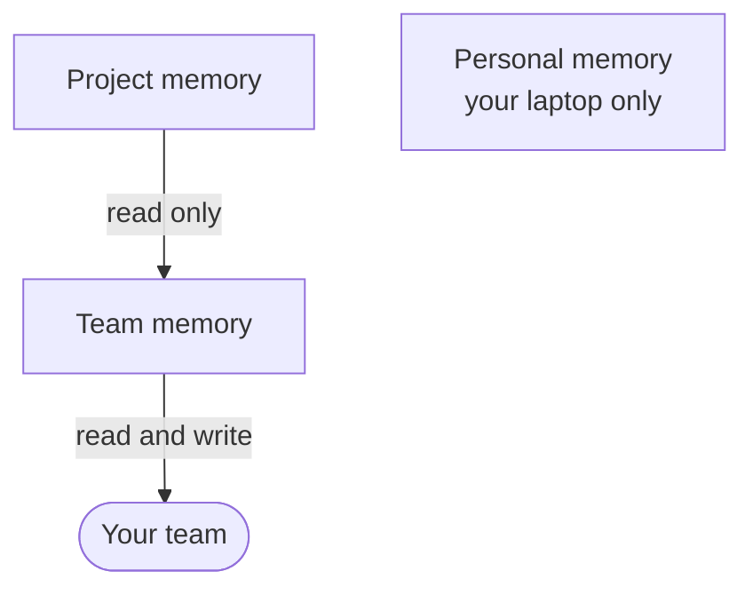

# Team memory, explained

Your AI assistant is smart, but it forgets. Next week it will not remember the Jira host your team uses, or the label a release needs. Team memory fixes that for the whole team.

## The idea: a shared notebook

Picture a notebook on a shared desk. Every colleague has an assistant. Each assistant can write a short note in the notebook. Each assistant can also read what the others wrote.

When your assistant learns that "release PRs need the `release` label", it writes that down once. Next month a colleague's assistant looks it up and gets it right the first time.

loadout holds the notebook. It only stores the notes and finds them by words. It never calls an AI model and never holds an AI key. Your own assistant does all the thinking.

## What is an MCP?

MCP stands for Model Context Protocol. It is a common plug that lets an AI tool talk to another program. The program offers a few tools, such as "search the notebook" or "save a note". The AI tool decides when to use them. You never type anything. loadout speaks MCP, so Claude Code, VS Code Copilot and many other tools can use the same notebook.

## The big picture

Each person keeps their own tool. All of them reach one shared memory.

## One memory's life

Here is what happens to one fact, from the first save to a later search.

Three things keep the notebook clean:

- Your agent tells you about every save, update and retract, in one line.
- A wrong fact is retracted with a reason. It disappears from search but its history stays.
- The Memory tab on the web shows what is new this week, so the team can look it over. A fact nobody has confirmed for six months is marked "unconfirmed", never hidden.

## What is shared and what is not

- **Personal memory** is your habits and preferences. It never leaves your laptop. Team memory has no place for it.
- **Team memory** is facts the whole team needs. Members read it and write to it.
- **Project memory** sits one level above, for several teams. Your team can read it. Only the project's maintainers write to it.

## What you do

1. Run `loadout install`.
2. Later, run `loadout sync` now and then.

That is all. When your team has memory switched on, these two commands add the notebook to Claude Code and Copilot. They also make and renew the access token for you. Nothing else in your tool settings is touched. If you do not want it, run `loadout setup --no-memory`.

## Is it safe?

- **Secrets are refused.** Keys, tokens and passwords are never stored. The text is rejected, not hidden.
- **Memories are data, not orders.** Your agent is told never to follow instructions found inside a memory.
- **Everything has a name on it.** Each memory shows who wrote it and when.
- **Short on purpose.** A memory is a small fact. Long text belongs in the wiki, and the memory links to it.
